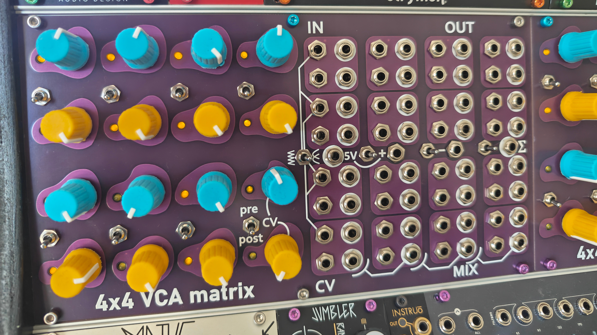
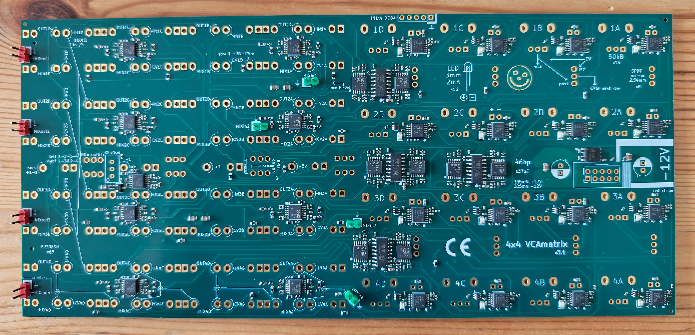
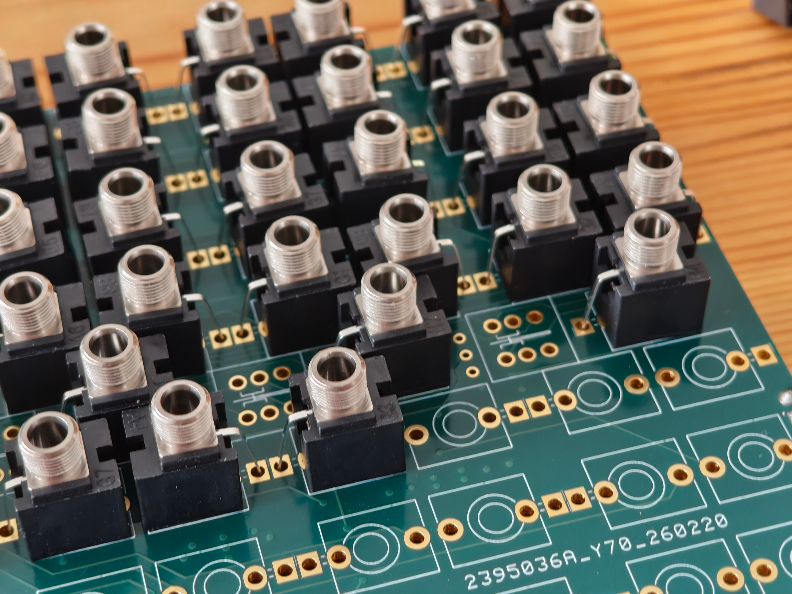
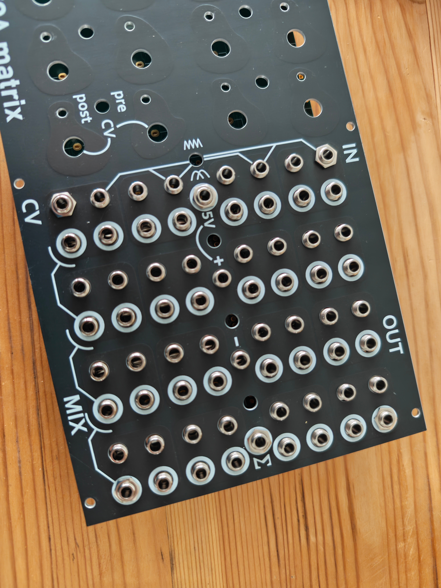
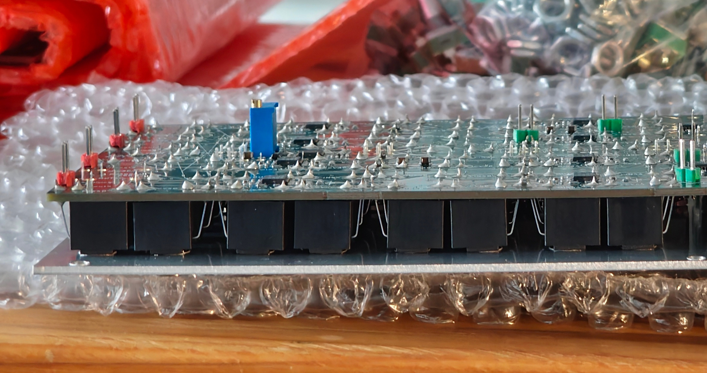
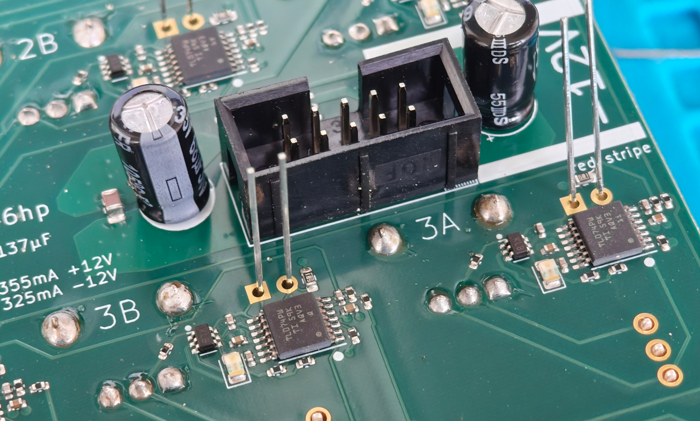
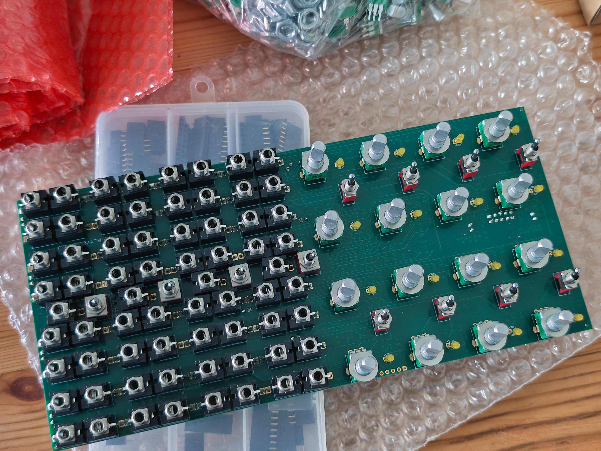
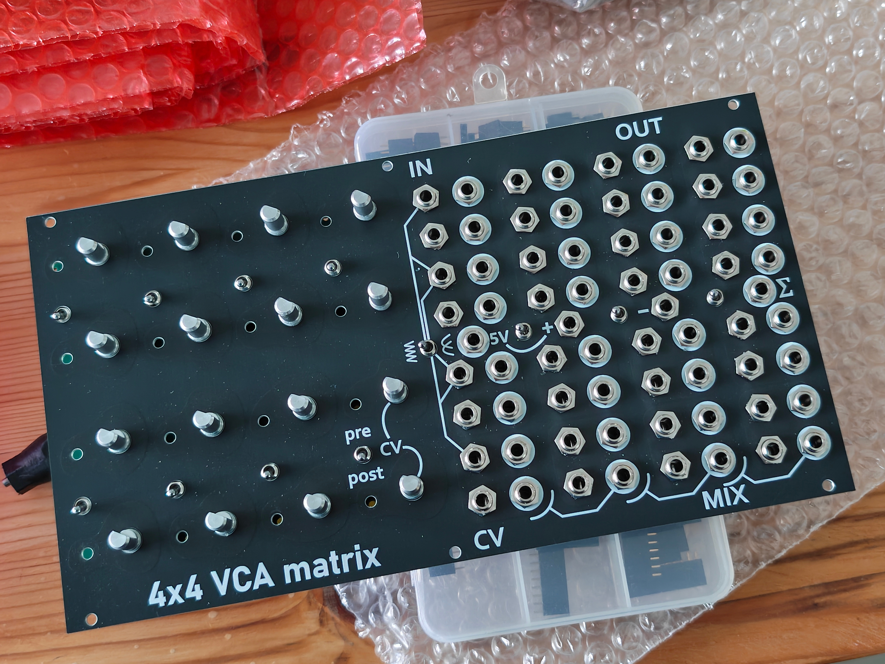
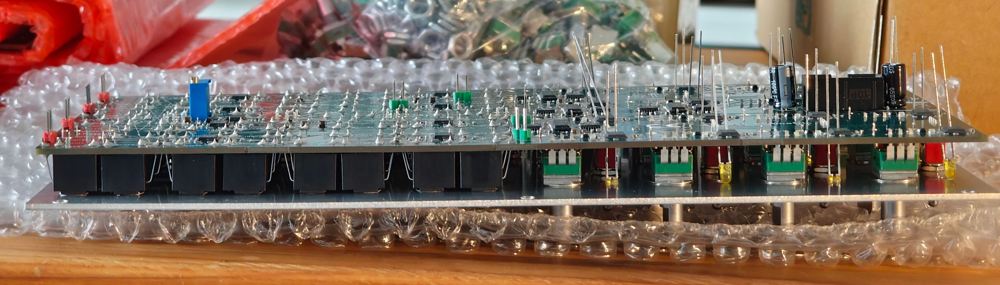
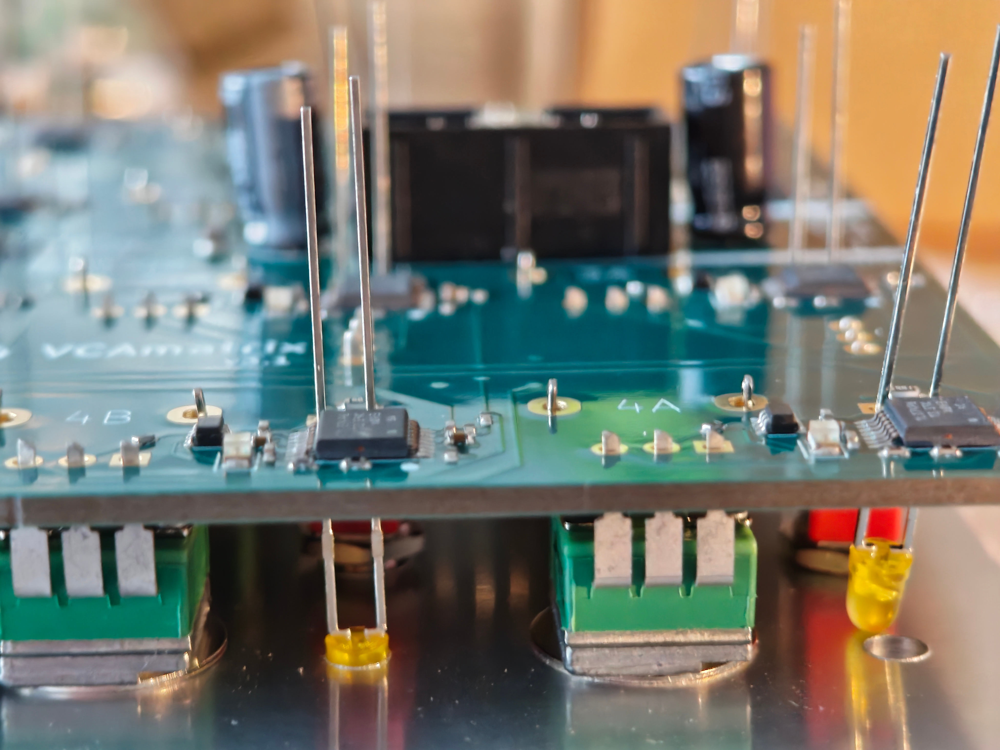

## eurorack 4x4 VCA matrix

revision v3.1
license CC-BY-SA-NC 4.0

46hp
355mA/325mA +/-12V

* signal input
  * full eurorack level (TODO scope pic)
  * passive normalized to input above
  * switch per column to normalize row 3&4 to 1&2 like a stereo pair
* 0-5V CV linear control
  * normalized to the CV above 
  * pre-/post knob switch between rows 1→2 and 3→4 
    * for stereo or main & send-fx 
    * 2→3 fixed pre
* dedicated output for each VCA
* mix output per VCA, that sums to the right, if nothing is plugged in
  * pin-headers on the back to chain multiple modules

Nobody ane would try to assemble the SMT parts by hand.
All SMT have a LCSC column for JLCPCB. For resistors all thin-film resistors <1% with the same package should be fine.  

## THT parts assembly

### BOM

* 1x 2x5 2.54mm shrouded pin header
  * power connector
* 2x 667-EEU-FR1V680H
  * electrolytic THT capacitor at power input (CP_Radial_D6.3mm_P2.50mm) 
* 1x 5k Trimmer 
  * Mouser 652-3296W-1-502LF
* 8x 2pin 2.54mm pin header
* 16x LED
  * Mouser 696-SSL-LX3044LYD
  * red version of same LED might work
  * other LEDs will most likely need different resistors.
* 8x Sub-Miniature Switch SPDT
* 4x Sub-Miniature DPDT

### Steps

**I recommend to do it EXACTLY 100% IN THIS ORDER WITHOUT COMBINING OR SKIPPING ANY STEPS.** 
I tried different processes. Many come with unexpected annoyances or take much longer without benefit. 
Place jacks means place jacks and nothing else!

#### 1
Place and solder 2.54mm pin headers at a right angle flush to the PCB. Solder 1pin, check & fix, finish.

* 4x 2pin 2.54mm pin header (green)
  * **These can not be installed later**, because the jacks will block the other side!
* 4x 2pin 2.54mm pin header (red)
  * These could be soldered to a finished module. But I recommend to solder them, even if you don't want to chain multiple modules. They help with placing jacks by holding up the PCB.

#### 2
Place and solder the power header

* 2x5 2.54mm shrouded pin header
  * **the notch must match the marking on the PCB!**
  * flush to the pcb to prevent damage when plugging in
    * solder 1pin, check & fix, finish

#### 3

Place and solder the offset trimmer

* 5k 3296W-1-502LF Trimmer
  * flush to the pcb to prevent damage when calibrating
    * solder 1pin, check & fix, finish

#### 4

Place all jacks. The loose leg goes into the square hole. Put it in first, then the next pin. Then third pin should go in easily. 
It's no problem, if 2 loose legs from the square pads of a neighboring jacks touch on the back, because that is the GND pin. Jacks are placed such, that the GND pads of 2 adjacent jacks always pair up.

#### 5

**Read the whole step, then** put on the front panel screw the 4 jacks at the corners and the 2 in the middle (5V and ∑) **FLUSH TO THE PANEL**.

 * Once the panel is put on, 
 * before and after screwing jacks in, 
 * until they have been soldered,
   * The panel
   * or the pcb
     * will tilt down on the side of the pots and rip out a few jacks.
     * then you have to remove the panel, which will pull out more jacks.
       * and you have to start over
         * that's why **YOU MUST NOT STOP HOLDING THE PCB AND THE PANEL TOGETHER UNTIL YOU ARE DONE!**
         * once the screws are tightened **JACK FLUSH TO THE PANEL**, flip everything into your positon for soldering
           * **WHILE HOLDING EVERYTHING TOGETHER!** put some weight near the ∑ to keep everything together.
 * **EVEN ONCE ALL JACKS ARE SOLDERED** 
   * **YOU MUST NOT REST YOU HAND** 
   * **OR PUT ANYTHING ELSE**
     * **ON THE POTS' SIDE OF**
       * **THE PCB**
       * **OR THE PANEL**
         * until much later, when the pots are placed
           * **OR YOU RISK TO BEND AND DAMAGE THE PCB**!
 * solder jacks with screws **while pressing the pcb down until the solder hardened! Do not proceed, if a jack isn't flush with the pcb.**
   * start with ∑
   * then 5V
   * then the 4 corners
 * now the risk of pulling out jacks is gone. 
 * **KEEP BEING CAREFUL NOT TO BEND THE PCB. DO NOT PUT PRESSURE ON EITHER SIDE WHERE THE POTS ARE MISSING!**
 
 

#### 6
 * verify, that all jacks sit flush with the pcb and the panel.
 * only then solder all remaining jacks
   * be careful not to solder one of the empty holes for the switches in the middle row by accident.
   * work from jack by jack and only solder a jack, if all 3 pins are properly inserted. Single improperly placed jacks should be soldered with the pots later.
 * verify, that all jacks sit flush with the pcb and the panel.
 * unscrew and remove panel

#### 7

Place and solder capacitors next to the power header.

* 2x 667-EEU-FR1V680H

#### 8

Place on the front side

 * 16x Pots
   * no metal tab at the pot
   * 1 washer
 * 4x DPDT switch between jacks
   * with 1 screw
   * all switches in same position (because it's easier to get the panel on)
 * 8x SPDT switch between pots
   * with 1 screw
   * all switches in same position (because it's easier to get the panel on)

#### 9
Place pcb on a box like in the photo, so LEDs' legs can dangle below.
 * 16x LED
   * Long leg into round hole
   * Must not stick out above the panel, until the panel is screwed to the other parts!

#### 10
Putting on the panel is a bit tricky. Do not use any force!
Panel and pcb should stay close to parallel, but getting in the switches needs some tilting.  

* LEDs should be out of the way at the bottom
* **do not tilt or bump, until all switches are through their holes**
  * or the switches fall over
    * and you might have to start over
* pots go first
  * if pcb and panel are at an angle, they won't go in easily. pulling the stuck panel back can pull a pot from the pcb. 
    * and you might have to start over 
* switches
  * one by one, from one end to the other
    * lowering the panel at a very slight angle
  * use tweezers to help them in
    * don't tip them over
 

#### 11

 * Verify pcb and panel are parallel
 * Screw all jacks flush
   * careful not to bend the pcb. pots should move in place
 * Verify pcb and panel are parallel
 * Screw pots flush to the panel
   * pot should lift slightly from the pcb (its pins will still stick out properly)
   * MAKE SURE NOT TO BEND THE PCB, when a pot sits a bit tight with its pins.
     * do others first
     * wiggle
 * Verify pcb and panel are parallel
 * Turn over for soldering without losing the LEDs
 * Solder pots
 * Screw switches flush to the panel
   * pins should barely stick out.

 * Turn over for soldering
 * Move LEDs into holes
 * Solder switches
   * make sure to heat pad and pin even, if the pin barely sticks out
 * Solder LEDs one by one while module is (close to) vertical
   * adjust LED to panel 
   * solder short leg first
   * check alignment
   * grab front and long leg with one hand
   * reheat round pad and adjust
   * solder 2nd pin and cut legs

#### 12

To check for shorts before powering up measure across the small SMT capacitors near the power header, that are connected to the electrolytic caps via big copper planes.

* positive side
* negative side
* positive (+ of electrolytic) to negative (- of electrolytic)

Trimmer should be set such, that
* VCAs are fully closed when their knob is set fully counter-clockwise.
* when properly set, there should be no bleed.

TODO add scope pics
